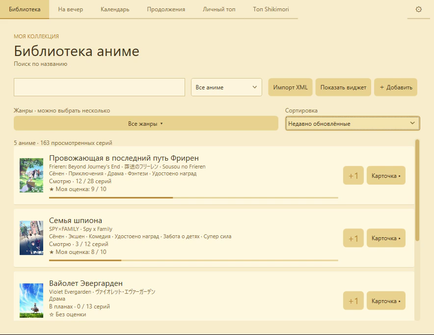
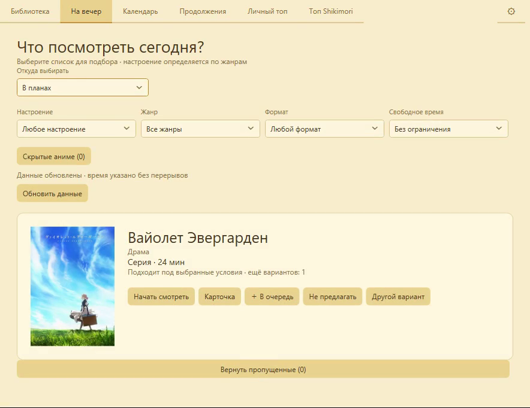
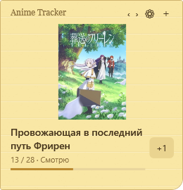

# Anime Tracker

Минималистичный трекер аниме с необязательным виджетом в виде жёлтой бумажной записки. Ведите библиотеку, отмечайте серии кнопкой **+1** и выбирайте аниме на вечер. Для Windows доступна переносимая версия; для Mac с Apple Silicon подготовлена версия.

**Windows: C# / WPF / .NET Framework 4.8 · macOS/Linux: C# / Avalonia / .NET 10 · интерфейс на русском**

## Как выглядит приложение

Windows-сборка 1.0.1 на демонстрационной библиотеке:

| Библиотека | Подбор на вечер |
| --- | --- |
|  |  |

Виджет «Обложка с прогрессом»:



[Короткая демонстрация Windows — MP4, 20 секунд](docs/media/1.0.1/windows-demo.mp4). [Проверки и ограничения 1.0.1](docs/validation/1.0.1-windows.md). [Скачать релиз 1.0.1](https://github.com/MimicBYE/AnimeTracker/releases/tag/v1.0.1).

Тёмная тема в разработке после 1.0.1: [Windows — проверочный рендер](docs/media/at-24/windows-dark.png), [общий интерфейс macOS/Linux — рендер Avalonia на Windows](docs/media/at-24/desktop-dark.png). Искусственная библиотека; [проверки и ограничения AT-24](docs/validation/2026-10-31-dark-theme.md).

## Возможности

- **Оформление:** светлая бумажная и тёмная графитовая темы. В настройках выберите «Тема → Светлая / Тёмная» и нажмите «Применить»; выбор сохраняется, окна и виджет обновляются без перезапуска. Доступно в сборках dev после AT-24; старый стабильный 1.0.1 не изменён.
- **Библиотека:** пять статусов, прогресс по сериям, оценки, личные заметки и поиск по сохранённым русским, английским, японским и латинским названиям.
- **Поиск в Shikimori:** подсказки при вводе, название, обложка, количество серий и жанры выбранного сезона.
- **Виджет:** три варианта оформления — бумага, компактная полоска, обложка с прогрессом. Закрепление тайтла, переключение между текущими аниме и быстрое добавление.
- **Очередь просмотра:** добавление из карточки и вечернего подбора; источник «Моя очередь» в подборе на вечер. Отдельная вкладка убрана.
- **«На вечер»:** подбор из планов, первых 200 позиций топа Shikimori или своей очереди. Фильтры по настроению, жанру, формату и свободному времени.
- **Скрытые рекомендации:** «Не предлагать» исключает тайтл из вечернего подбора; вернуть его можно через «Скрытые аниме».
- **Продолжения:** отдельная вкладка с продолжениями просмотренных аниме. В подборе из топа проверяется вся цепочка предыдущих сезонов.
- **Топы:** общий рейтинг Shikimori, личный топ с категориями, сравнение тайтлов с одинаковой оценкой и экспорт подборки в PNG.
- **Календарь:** ближайшие серии из «Смотрю» и «В планах», режимы месяца и недели, московское время UTC+3.
- **Арки и филлеры:** встроенный справочник для отдельных тайтлов, ручные арки, несколько диапазонов серий и собственные исправления.
- **Импорт MyAnimeList:** XML и GZIP с предварительным просмотром, статусами, оценками и просмотренными сериями.
- **Локальное хранение:** XML-файлы, резервные копии, сохранение фильтров и сортировки, работа с библиотекой без интернета.

## Скачать и запустить

В разделе **Releases** этого репозитория выберите архив `AnimeTracker-1.0.1-windows-x64.zip`.

1. Распакуйте архив целиком в отдельную папку, доступную для записи, например `Документы\AnimeTracker`.
2. Запустите `AnimeTracker.exe`. При обычном запуске появится виджет и значок в системном трее.
3. Откройте библиотеку двойным щелчком по виджету или значку в трее.
4. Добавьте аниме через поиск либо импортируйте список из MyAnimeList.

Установщик и учётная запись приложения не нужны. Папка `data` создаётся при первом сохранении. Не запускайте EXE прямо внутри ZIP и не размещайте переносимую версию в папке без прав записи.

Начиная с 1.0.1 усилена защита хранения: изменение прогресса подтверждается после записи. При повреждении `library.xml` приложение проверяет `.bak`, восстанавливает предыдущую копию и сообщает об этом; повреждённый оригинал остаётся рядом как `.corrupt-*`. Последние изменения после создания копии могут отсутствовать — проверьте прогресс. Если копия неверна или восстановление не удалось, запись блокируется. Перед ручным восстановлением закройте приложение и сохраните всю папку данных отдельно.

### Требования

- Windows 10 или Windows 11, **x64** для готового релизного архива.
- [.NET Framework 4.8 или 4.8.1](https://learn.microsoft.com/en-us/dotnet/framework/install/). Это именно .NET Framework; отдельный современный .NET Runtime его не заменяет.
- Интернет для новых запросов Shikimori, загрузки обложек и обновления расписания. Ручная библиотека, сохранённые данные и XML-импорт работают офлайн.

Windows-сборка не имеет цифровой подписи. Для **Apple Silicon / macOS 14+** подготовлен `AnimeTracker-1.0.1-macos-arm64.zip` с приложением **Anime Tracker.app** и включённым .NET. Инструкция по переносу данных, сборке и ограничениям: [macOS](docs/MACOS.md). Порт ещё требует проверки на реальном Mac и не подписан Developer ID.

**Linux x64 / Ubuntu 24.04 / Linux Mint 22.x:** новые сборки `dev` после AT-22 содержат `AnimeTracker-<версия>-linux-x64.tar.gz` со встроенным runtime. Распакуйте архив и запустите `./AnimeTracker`; ярлык меню и автозапуск настраиваются без root. Виджет по умолчанию выключен. [Linux: запуск, библиотеки, данные и ограничения](docs/LINUX.md). В прежнем стабильном 1.0.1 Linux-пакета нет.

Подробные [системные требования](docs/SYSTEM-REQUIREMENTS.md) разделяют ограничения текущих пакетов, предварительные бюджеты и фактические проверки. macOS 14 разрешена метаданными архива 1.0, но уже вне активной матрицы .NET 10; для следующей проверки порта выбрана macOS 15+. [План платформ](docs/PLATFORM-ROADMAP.md) содержит состояние Linux и будущие Android/iOS; мобильных пакетов пока нет.

## Как пользоваться

### Виджет и трей

- **+1** отмечает следующую серию. При достижении известного общего числа тайтл становится просмотренным.
- Один клик по бумаге раскрывает или сворачивает виджет; двойной открывает библиотеку.
- Перетаскивание за бумагу перемещает виджет в пределах рабочей области экрана.
- По умолчанию показывается последнее изменённое аниме. Закрепление доступно в карточке и настройках виджета.
- Шестерёнка **⚙** справа в ряду вкладок открывает отдельную страницу настроек Windows: виджет, оформление, закреплённое аниме, автозапуск, папка данных и резервная копия ZIP. Снимите **Показывать виджет**, чтобы отключить его; выбор сохраняется после перезапуска. Вернуть виджет можно кнопкой в библиотеке или из меню трея.
- Закрытие библиотеки оставляет приложение в трее. Для полного завершения выберите **Выход** в меню трея.
- Автозапуск включается через **⚙ → Запускать вместе с Windows → Применить**. Создаётся проверенный ярлык `Anime Tracker.lnk` в пользовательской папке «Автозагрузка», с `--startup` и рабочей папкой приложения. Если папка приложения перемещена или запуск нужно восстановить, включите настройку и снова нажмите **Применить**. Старая запись `Run` переносится после успешного создания ярлыка. Windows может отдельно отключить приложение в своём списке автозагрузки. [Штатные способы Windows](https://support.microsoft.com/en-us/windows/experience/startup-boot/configure-startup-applications-in-windows).
- Локальный журнал этапов запуска Windows: `%LOCALAPPDATA%\AnimeTracker\diagnostics\startup.log` (порог ротации 64 КиБ плюс одна предыдущая копия). Он помогает отличить отсутствие запуска, уже работающий экземпляр и ошибку инициализации; библиотека и ключи в журнал не записываются. Реальный запуск при следующем входе нужно проверять отдельно от ручного запуска ярлыка.

Виджет прикрепляется к рабочему столу Explorer и рассчитан на сохранение видимости при Win+D. Этот способ зависит от устройства рабочего стола Windows: после обновлений или при использовании сторонней оболочки поведение может отличаться. **Показать виджет** и **Вернуть виджет на экран** помогают восстановить его положение.

### Очередь и подбор на вечер

Добавляйте незавершённые тайтлы в очередь из карточки или подбора на вечер. Отдельной вкладки очереди больше нет. Сохранённые записи остаются доступны в источнике **Моя очередь**; завершённые и удалённые автоматически исключаются.

В источнике **Моя очередь** подбор предлагает первый подходящий тайтл с учётом фильтров. **Другой вариант** временно пропускает предложение. **Не предлагать** сохраняет скрытие после перезапуска; оно действует на все источники вечернего подбора и не удаляет аниме из библиотеки или очереди.

В источнике **Топ Shikimori** исключаются просмотренные тайтлы, анонсы и продолжения с незавершёнными предыдущими сезонами. Проверка использует связи `prequel`; при непроверенных связях продолжение не предлагается. Побочные истории и альтернативные версии не считаются обязательными предыдущими сезонами.

### Импорт из MyAnimeList

1. Откройте [экспорт MyAnimeList](https://myanimelist.net/panel.php?go=export) и скачайте **Anime List**.
2. Откройте **⚙ Настройки → Данные и резервные копии → Импорт XML из MyAnimeList** и выберите `.xml`, `.gz` или `.xml.gz`. Распаковывать GZIP заранее не нужно.
3. Проверьте предварительный просмотр и подтвердите импорт.

Переносятся пять статусов, оценки, общее и просмотренное количество серий, признак пересмотра и его прогресс. Исходная запись MAL сохраняется дополнительно как XML.

Совпадения определяются по MAL ID, а для записей без ID — по единственному точному совпадению названия. При повторном импорте просмотренный прогресс не уменьшается. По умолчанию сохраняется местный статус; в окне импорта можно выбрать статус из XML. Перед записью сохраняются исходный экспорт и копия библиотеки в `data/imports/`.

Импорт не синхронизирует аккаунт MAL и не выполняет массовое обогащение новых записей через Shikimori.

### Обновления и справочники

Число серий выходящих аниме и даты ближайших выпусков проверяются, пока приложение работает. Для подходящих записей используется интервал обновления шесть часов, после ошибок проверка повторяется. Личный статус, просмотренные серии и оценка фоновым обновлением не меняются.

Справочник именованных арок встроен в сборку: Naruto (2002), Bleach (2004) и One Piece. Покрытие частичное: у Naruto шесть именованных арок до 135-й серии, у One Piece отметки серий до 1168-й. Shippuden и Thousand-Year Blood War — отдельные записи. Справочник не обновляется в реальном времени; неизвестные серии не считаются каноном. Для других тайтлов предусмотрены ручные арки и загрузка отметок серий через Jikan при наличии данных у источника.

## Данные, резервные копии и обновление приложения

В Windows личные данные находятся в `data` рядом с EXE. В macOS — в `~/Library/Application Support/AnimeTracker`:

| Файл / папка | Содержимое |
| --- | --- |
| `library.xml` | Библиотека, прогресс, оценки, заметки и метаданные |
| `watch-choices.xml` | Очередь просмотра и скрытые рекомендации |
| `view-settings.xml` | Поиск, сортировка и фильтры библиотеки |
| `appearance-settings.xml` | Светлая / тёмная тема приложения |
| `widget-settings.xml` | Оформление и закрепление виджета |
| `personal-order.xml` | Сравнения тайтлов в личном топе |
| `arcs.xml` | Собственные арки и исправления справочника |
| `covers/` | Загруженные обложки |
| `imports/` | Исходные экспорты и копии перед импортом |

Другие XML-файлы хранят кеш расписания и каталога. Для ключевых файлов создаётся предыдущая версия с расширением `.bak`; это не заменяет отдельную резервную копию.

**Обновление:** завершите приложение через трей, скопируйте папку `data` в безопасное место, распакуйте новую версию поверх программных файлов и сохраните свою папку `data`. В релизном архиве личных данных нет.

Для переноса на другой компьютер закройте приложение и скопируйте всю его папку. Для восстановления из `.bak` сначала сохраните повреждённый файл отдельно, затем замените его резервной копией при закрытом приложении.

Запросы каталога и изображения загружаются непосредственно из внешних источников. Личные статусы, оценки и заметки не синхронизируются с аккаунтами Shikimori/MAL. Резервные копии, экспорты и свою папку `data` не следует добавлять в публичный репозиторий.

## Структура проекта

| Путь | Назначение |
| --- | --- |
| `AnimeTracker.exe` | Запуск Windows-приложения из корня папки |
| `src/AnimeTracker.Windows/` | Интерфейс WPF, трей и закрепление Windows |
| `src/AnimeTracker.Desktop/` | Интерфейс Avalonia и интеграция macOS |
| `src/AnimeTracker.Core/` | Единый TrackerService для всех клиентов, доменные правила, XML, каталог и импорт |
| `scripts/` | Сборка, упаковка релизов и генерация иконок |
| `tests/AnimeTracker.CoreTests/` | Проверки общей логики и переноса данных |
| `tests/Shared/` | Одинаковые контракты сервиса под .NET и Windows/.NET Framework |
| `docs/` | Инструкции, история изменений и атрибуция |
| `data/` | Личная Windows-библиотека; не включается в Git/релиз |
| `dist/windows/`, `dist/macos/`, `dist/linux/` | Готовые архивы по платформам |
| `artifacts/` | Промежуточные сборки, проверки и архив диагностики |
| `.tools/` | Локальный SDK/кеш разработчика; не часть исходников |

В скачанном архиве Windows запускайте **AnimeTracker.exe**, в Mac-архиве — **Anime Tracker.app**. В репозитории хранятся исходники; EXE появляется после сборки. Точки входа в коде: `src/AnimeTracker.Windows/App.cs` и `src/AnimeTracker.Desktop/Program.cs`.

Windows и Avalonia используют один сервис операций библиотеки и обновления серий. Нативные функции и интерфейс находятся в платформенных адаптерах. Карта файлов, правила сохранения и расширения — [архитектура ядра](docs/ARCHITECTURE.md).

## Сборка из исходников

Порядок работы с issues и ветками — [CONTRIBUTING.md](CONTRIBUTING.md), правила для агентов — [AGENTS.md](AGENTS.md). [CI](docs/CI.md) проверяет общую логику на трёх ОС, собирает Windows/macOS/Linux и автоматически публикует стабильные релизы из `main` и промежуточные из `dev`. Уже выпущенные версии не перезаписываются.

Требования безопасности и приватный канал сообщения об уязвимостях — [SECURITY.md](SECURITY.md). NuGet Audit, Dependency Review и Dependabot проверяют зависимости; High/Critical блокируют CI и публикацию.

Для Windows используются C# 5, WPF и библиотеки установленного .NET Framework. Внешних NuGet-пакетов нет. Для приведённого скрипта нужна 64-битная Windows с .NET Framework 4.8+ и Windows PowerShell 5.1 или PowerShell 7.

Из папки проекта:

```powershell
.\scripts\build-windows.ps1
```

Результат — `AnimeTracker.exe` и его конфигурация в корне проекта. Если EXE запущен, завершите его через трей или соберите в другую папку:

```powershell
.\scripts\build-windows.ps1 -OutputPath .\artifacts\local\AnimeTracker.exe -Platform x64
```

### Проверки и подготовка релиза

```powershell
.\scripts\release-windows.ps1
```

Скрипт собирает EXE в отдельной рабочей папке, запускает встроенные проверки и тест XML/GZIP-импорта, создаёт переносимый архив, архив исходников и SHA-256. Используется явный список файлов: личная библиотека, кеши, тестовые данные и диагностические утилиты не упаковываются. Новая сборка не заменяет запущенный рабочий EXE.

Готовые Windows-файлы находятся в `dist/windows/`. Подробности проверки конкретной сборки — в `artifacts/`.

Порт macOS собирается SDK .NET 10 из `global.json` и PowerShell 7: `sh scripts/build-macos.sh` на Mac или `./scripts/build-macos.ps1` в PowerShell. Подробности — [инструкция macOS](docs/MACOS.md). Общие проверки: `dotnet run --project tests/AnimeTracker.CoreTests`. Проверки релизной инфраструктуры: `./tests/Release.Tests.ps1`.

Подготовка чистой папки для GitHub: `./scripts/prepare-github.ps1`. Подробности — [подготовка GitHub-релиза](docs/GITHUB-RELEASE.md).

Для ручной проверки Windows:

```powershell
Start-Process .\AnimeTracker.exe -ArgumentList '--self-test' -Wait
Get-Content .\test-result.txt
Start-Process .\AnimeTracker.exe -ArgumentList '--import-test' -Wait
Get-Content .\import-test.txt
```

Обе проверки используют тестовые данные. Аргумент `--library` открывает библиотеку сразу. Диагностика закрепления виджета `--verify` запускает графический интерфейс и сохраняет отчёт и изображения рядом с EXE.

## Источники и ограничения

- [Shikimori GraphQL API](https://shikimori.io/api/doc/graphql) — каталог, рейтинг, связи сезонов и расписание.
- [Jikan API](https://docs.api.jikan.moe/) — отметки отдельных эпизодов при доступности у источника.
- [AnimeFillerList](https://www.animefillerlist.com/) и сообщества Fandom — встроенный справочник арок и типов серий.

Источники могут быть недоступны, менять данные или ограничивать запросы. Названия арок могут содержать спойлеры. Проект не является официальным клиентом этих сервисов.

Атрибуция, даты снимков и условия для сторонних материалов приведены в [THIRD-PARTY-NOTICES.md](docs/THIRD-PARTY-NOTICES.md) и [ArcCatalog-SOURCES.txt](docs/ArcCatalog-SOURCES.txt). Лицензия исходного кода проекта пока не выбрана; разрешительная лицензия автоматически не подразумевается.
