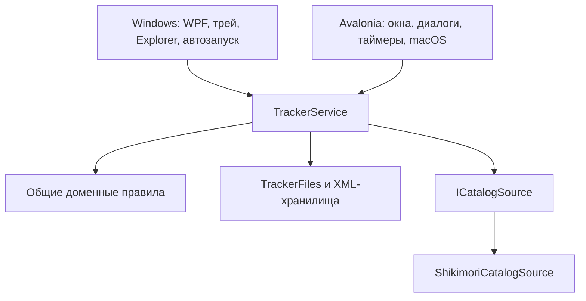

# Общее ядро Anime Tracker

С 28 октября 2026 (AT-20) Windows/WPF и Avalonia используют один `TrackerService` из `AnimeTracker.Core`. Здесь находятся сценарии работы с данными; платформенные проекты отвечают за представление и жизненный цикл. Формат XML и расположение существующих пользовательских файлов сохранены.

## Где искать код

| Файл | Ответственность |
| --- | --- |
| `src/AnimeTracker.Core/TrackerService.cs` | Открытие/восстановление библиотеки, блокировка записи, +1/отмена, карточка, статусы/оценки/заметки, удаление/восстановление, MAL commit, очередь/скрытие, виджет, арки, уведомления |
| `src/AnimeTracker.Core/TrackerRefresh.cs` | Общий выбор записей для обновления, пакеты до 50 ID, интервал шесть часов, расписание/метаданные, отмена, сериализация запросов, защита устаревших ответов |
| `src/AnimeTracker.Core/TrackerTransfers.cs` | Перенос совместимой папки с резервной копией, экспорт ZIP; родительскую/дочернюю папку импортировать нельзя |
| `src/AnimeTracker.Core/TrackerFiles.cs` | Имена файлов относительно переданного корня, проверка выхода относительного пути за корень |
| `src/AnimeTracker.Core/CatalogSource.cs` | Внедряемый источник `ByIds`; стандартный адаптер вызывает общий клиент Shikimori |
| `src/AnimeTracker.Core/Domain.cs`, `LibraryStorage.cs`, `LibraryView.cs`, `ViewPreferences.cs`, `ArcCatalog.cs`, `Catalog.cs` | Существующие модели, правила и XML/каталог, используемые сервисом и интерфейсами |
| `src/AnimeTracker.Desktop/AppStore.cs` | Тонкий адаптер: системная папка данных и запрет применения фонового обновления во время модального диалога |
| `src/AnimeTracker.Windows/App.cs`, `EpisodeUpdates.cs`, остальные WPF-файлы | Создание сервиса, ввод/отрисовка, вызовы общих операций, UI-таймер и проверка открытых окон; без второго алгоритма обновления библиотеки |
| `tests/Shared/TrackerServiceTests.cs` | Один набор контрактов для современного .NET и Windows/.NET Framework |

Отдельный проект `Application` пока не требуется: общий слой приложения размещён внутри Core и использует совместимый с C# 5 код. Avalonia получает Core через `ProjectReference`; Windows компилирует те же исходники явным списком `scripts/windows-sources.txt`. Таким образом, это один исходный код с двумя способами сборки. Поддержка .NET Framework не требует перевода WPF на другой UI или runtime.

## Правила операций

Один сервис владеет одной папкой данных в одном процессе. Хост вызывает операции из одного сериализованного контекста (UI dispatcher). Это не многопроцессное хранилище: два приложения или мобильное расширение не должны независимо переписывать одни XML. `SemaphoreSlim` согласует сетевые операции одного сервиса, а не блокирует папку между процессами.

Команда изменения личной библиотеки сначала сохраняет подготовленное состояние и затем публикует его в памяти. Отказ записи передаётся хосту, который показывает ошибку. `Changed` означает, что операция уже применена; обработчики должны обновлять представление без записи в библиотеку и без исключений. Не все команды обязаны вызывать событие при отсутствии изменений. Коллекции пока доступны для чтения существующему UI; новый код не должен обходить сервис и менять личные поля напрямую. Настройки поиска остаются редактируемым черновиком с явным `SaveView`; координаты виджета остаются частью платформенного drag-сценария.

Обновление серий делает снимок **после** ответа сети. Оно переносит только Total/EpisodesAired/AiringStatus/EpisodesChecked и сохраняет существующие объекты Anime. Статусы, просмотренные серии, оценки, заметки, ID, поля MAL/пересмотра и Updated не переписываются каталогом. Ответ после отмены, Reload, импорта или запрета хоста не применяется. Повторное обновление серий при занятом каталоге пропускается; запрос метаданных ждёт освобождения и поддерживает отмену ожидания.

Расписание и метаданные — восстанавливаемый кеш. Сохранение schedule.xml и library.xml не является общей файловой транзакцией: при отказе библиотеки кеш расписания может быть записан раньше. При этом личная библиотека в памяти/на диске остаётся прежней, событие успеха не отправляется, проверка может быть повторена. Между пакетами по 50 записей возможен частичный успешный результат; отмена не откатывает ранее сохранённые пакеты.

MAL commit заново сопоставляет предварительно прочитанные записи с текущей библиотекой, делает резервную копию и сохраняет результат перед заменой состояния. Устаревшие ссылки на Anime после Reload/импорта нужно получать заново. Нормализация необычного импортированного прогресса при обычном редактировании заметок/оценок не выполняется.

## Что остаётся платформенным

Выбор системной папки, файловые диалоги, доступ к потокам/URI, таймеры, показ ошибок, UI-поток, декодирование обложек, экспорт PNG, трей, закрепление виджета и автозапуск принадлежат хосту. Win32/COM/Objective-C не переносятся в Core. `Catalog.CoverPath`, зависящий от папки Windows EXE, находится в Windows-адаптере.

AT-22 добавляет в TrackerFiles раздельные data/config/cache корни для Linux; Windows/macOS сохраняют прежнюю единую папку. Backup собирает логический набор, импорт при разделённых путях или активной блокировке заменяет файлы с backup/rollback. Linux-хост удерживает файловую блокировку до завершения процесса и обрабатывает запрос открытия от второго экземпляра; остальные хосты используют прежнюю политику. Мобильный URI-import, безопасное восстановление ZIP и синхронизация требуют следующих этапов. Linux-клиент/ограничения описаны в [инструкции](LINUX.md); это не означает готовые мобильные платформы или проверенный Mac UI.

## Как добавлять функцию

1. Правило и работу с данными разместить в Core; сценарий, затрагивающий несколько правил/файлов, оформить методом сервиса.
2. Внешнюю возможность вводить узким контрактом по необходимости. Для обновлений уже внедряются `ICatalogSource` и часы UTC; диалог/таймер остаются снаружи.
3. Оба интерфейса вызывают общий метод. Общие настройки и доступ к данным не копировать в новый AppStore.
4. Проверить успех, отказ записи, перезапуск и сохранность несвязанных личных полей. Для сети — отмену и изменение данных во время ожидания. Общие контракты писать на C# 5 в `tests/Shared`.
5. Новый исходник вне SDK auto-include добавить в `windows-sources.txt`; проверить Windows release/source rebuild и Core/desktop tests. Обновить документы при изменении форматов/требований.

Результаты AT-20: [отчёт проверки](validation/2026-10-28-shared-core.md). Последующие платформы: [roadmap](PLATFORM-ROADMAP.md).

## Оформление Light/Dark (AT-24)

`Core/Appearance.cs` содержит `AppearanceOptions` и общую `PaperPalette`: прежние светлые оттенки и нейтральные серые тёмные. `TrackerService.SetAppearance` атомарно сохраняет `appearance-settings.xml` с `.bak`, затем публикует `AppearanceChanged`; библиотечный `Changed` не вызывается. Ошибка записи не меняет активный выбор. После AT-26 по умолчанию System; прежние Light/Dark сохраняются. Повреждённая настройка читается из валидной копии либо используется System. Перенос/backup включают файл; в XDG это ConfigRoot.

`Desktop/DesktopTheme.cs` обновляет общие кисти, DynamicResource и RequestedThemeVariant, включая ресурсы состояний Fluent. `Windows/WindowsTheme.cs` обновляет общие кисти через binding (WPF не должен замораживать их в стилях/рисунках), DynamicResource, заголовки DWM и меню трея. Оба клиента держат выбор в черновике до «Применить»; системная тема ОС не меняется. Переключение не пересоздаёт библиотеку. Непрозрачный Explorer-виджет Windows сохранён. Нативные системные диалоги и меню macOS/Linux оформляет ОС.

`Core/AppearanceBinding.cs` связывает выбор сервиса с ISystemAppearance и UI-диспетчером. Он разрешает System в эффективную Light/Dark, игнорирует повторные значения, читает актуальный ручной выбор при обработке отложенного уведомления и отписывается при Dispose. Уведомление ОС не вызывает SetAppearance и не пишет XML. Windows-адаптер читает HKCU AppsUseLightTheme и слушает SystemEvents.UserPreferenceChanged; Avalonia-адаптер использует PlatformSettings.GetColorValues/ColorValuesChanged, без зависимости от RequestedThemeVariant приложения. Нет polling или изменения темы ОС; недоступный сигнал означает Light.

Регрессии: `tests/Shared/SystemAppearanceTests.cs`, `tests/Shared/AppearanceTests.cs`, `tests/AnimeTracker.DesktopTests/ThemeTests.cs`, WPF `--theme-test`. Последний работает до обычного старта приложения, не использует mutex/личную data, не закрепляет виджет и не меняет автозапуск. Windows release проверяет его из бинарного ZIP и повторно из пересобранного source ZIP.
