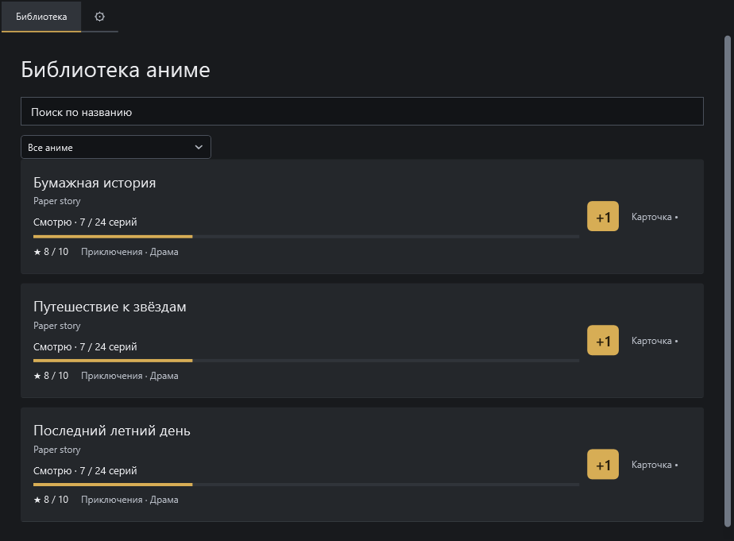
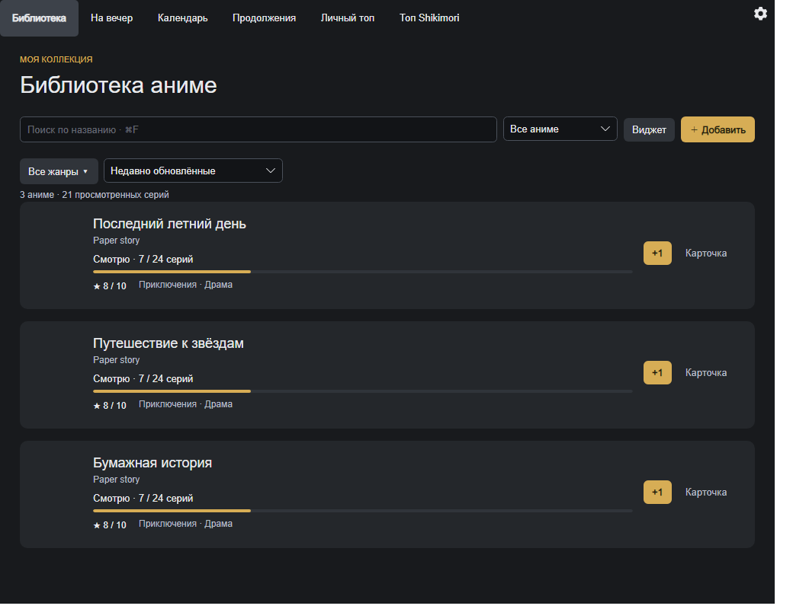

# Anime Tracker 1.1.0

Обновление для Windows, macOS и Linux: встроенный установщик новых версий, системная/тёмная тема, общее ядро и более понятные повседневные действия.

## Что изменилось после 1.0.1

- **Обновление из приложения:** ⚙ → Обновления… → Проверить → Скачать и установить. Прогресс и отмена загрузки, SHA-256/размер, проверка платформы, резервные копии, перезапуск по прежнему пути и откат программы при отказе запуска/таймауте. Автопроверка вместе с сериями; установка всегда по кнопке. Stable не получает dev без явного выбора. Исправлены длинные пути backup на Windows.
- **Темы на всех платформах:** системная по умолчанию, светлая бумажная или тёмная графитовая с жёлтым акцентом. Смена системной темы обновляет окна/виджет без перезапуска; ручной выбор сохраняется отдельно от библиотеки.
- **Linux x64:** самостоятельный tar.gz для Ubuntu 24.04 / Mint 22.x, X11/XWayland; XDG-папки, меню/автозапуск текущего пользователя. Основное окно работает без трея, виджет по умолчанию выключен.
- **Повседневный интерфейс:** заметнее главные действия, контрастнее дополнительный текст, прогресс отделён от названий. Импорт MAL находится в настройках. Настройки Avalonia прокручиваются с закреплёнными кнопками; отмена импорта сохраняет черновик оформления/автозапуска.
- **Единое ядро:** общие операции личной библиотеки, импорта, виджета, очереди/скрытий, арок и обновления каталога. Устаревшие/отменённые ответы не перезаписывают изменения пользователя. XML обратно совместим.
- **Автозапуск Windows:** проверенный Unicode-ярлык с рабочей папкой и фактическим путём EXE; перенос старой Run-записи, повторное применение восстанавливает регистрацию. Владелец подтвердил запуск после перезагрузки.

## Скачать

| Платформа | Архив |
| --- | --- |
| Windows 10/11 x64, Framework 4.8+ | `AnimeTracker-1.1.0-windows-x64.zip` |
| Mac Apple Silicon | `AnimeTracker-1.1.0-macos-arm64.zip`, runtime внутри; рекомендуем macOS 15+ |
| Ubuntu 24.04 / Mint 22.x x64 | `AnimeTracker-1.1.0-linux-x64.tar.gz`, runtime внутри |
| Исходники и инструкции сборки | `AnimeTracker-1.1.0-source.zip` |

Общий `SHA256SUMS.txt` содержит контрольные суммы четырёх архивов. В архивы не включены личные данные, SDK и кеши.

## Первый переход со старой версии

В 1.0/1.0.1 и dev до AT-28 встроенного обновления нет. Один раз закройте приложение, сохраните данные отдельно и установите новый архив обычным способом. На Windows используйте прежнюю папку программы, сохранив `data`, чтобы путь автозапуска не изменился. На Mac данные находятся в Application Support вне `.app`; на Linux — в XDG-папках. Следующие совместимые версии устанавливаются из настроек.

[Установка, каналы и восстановление](https://github.com/MimicBYE/AnimeTracker/blob/v1.1.0/docs/UPDATES.md). Резервные копии обновления не удаляются автоматически. Откат программы не перезаписывает новый личный прогресс; снимок данных доступен отдельно. Отключение питания во время замены не гарантирует автоматического восстановления.

## Проверки и ограничения

CI проверяет Core/UI на Windows/macOS/Linux, упаковку трёх платформ, Windows rebuild из source ZIP, отдельные процессы установщика (ready/ошибка/таймаут/rollback), длинные пути, целостность архива и зависимости. Весь новый пакет проверен без Computer Use и без изменения рабочего приложения владельца. [Отчёт updater](https://github.com/MimicBYE/AnimeTracker/blob/v1.1.0/docs/validation/2026-11-03-app-updates.md), [границы выпуска](https://github.com/MimicBYE/AnimeTracker/blob/v1.1.0/docs/validation/1.1.0-release.md).

Ручная нативная установка через UI, Gatekeeper/SmartScreen, Mac Spaces/автозапуск, Linux GNOME/Cinnamon/KDE и новые проверки DPI/мониторов ещё нужны. Windows EXE не подписан; Mac имеет ad-hoc подпись без Developer ID/нотарификации. Метаданные Mac допускают 14.0, но активная матрица .NET 10 начинается с 15; Mac 14 не заявляется проверенным. Для Linux нужен X11/XWayland; ARM64/musl/native Wayland не входят в выпуск.

## Оформление

Проверочные изображения тёмной темы, сделанные в AT-24 на Windows с искусственной библиотекой:

| WPF Windows | Avalonia на Windows |
| --- | --- |
|  |  |

Это проверочные рендеры разработки, а не новые снимки нативных Mac/Linux. [Исторические скриншоты и видео Windows 1.0.1](https://github.com/MimicBYE/AnimeTracker/tree/v1.0.1/docs/media/1.0.1) остаются отдельно. Каталог/обложки зависят от внешних API; права на изображения принадлежат правообладателям. Лицензия собственного кода пока не выбрана. Старые теги и вложения сохранены.
