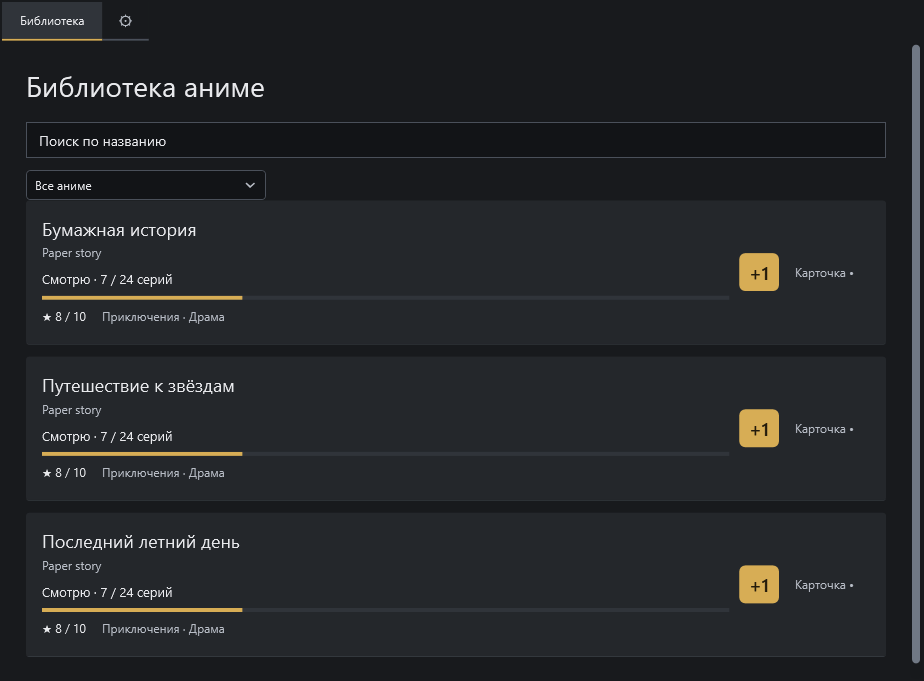
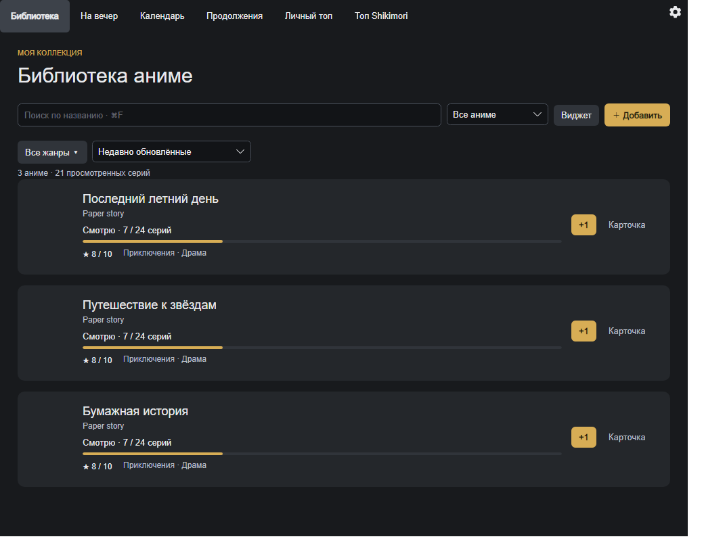
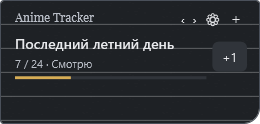
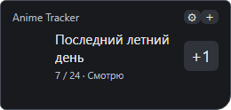

# Светлая и тёмная темы — AT-24

Дата: 31 октября 2026. Ветка AT-24 от dev 7ae2531. [Issue #24](https://github.com/MimicBYE/AnimeTracker/issues/24). Стабильный 1.0.1 и установленное рабочее приложение не заменяются.

## Поведение

Настройки → Тема приложения / Тема → «Светлая» или «Тёмная» → «Применить». Светлая бумажная палитра сохранена. По уточнению владельца тёмная палитра нейтральная: фон `#181A1D`, карточки `#24272B`, поля `#121417`, текст `#E8E9EC`, вторичный текст `#B8BDC6`, жёлтый акцент `#D7AD55`. Убрана стандартная белая заливка контейнера вкладок.

Выбор сохраняется в `appearance-settings.xml` отдельно от библиотеки. Запись через временный файл и `.bak`, уведомление интерфейса после успешной записи. На Linux файл находится в XDG ConfigRoot. Отдельный `AppearanceChanged` обновляет кисти/ресурсы, не пересоздаёт библиотечный список. Если в настройках изменена только тема, прежние настройки виджета повторно не применяются; это проверяется отсутствием библиотечных уведомлений. Импорт папки и резервные копии включают тему. Старые данные без файла темы открываются в светлой теме.

## Автоматические проверки

- Shared/Core и тот же набор под C# 5 / .NET Framework: default, сохранение/перезапуск, backup, повреждённый XML/неизвестная тема/DTD, отказ записи без изменения live/disk/event, отдельное уведомление, перенос плоской папки и XDG config, экспорт ZIP. XML личной библиотеки побайтно прежний. Контраст текста на основных поверхностях и текста основной кнопки ≥ 4.5:1 в обеих темах.
- WPF `--theme-test`: повторное переключение уже созданных окон/полей, рисунок бумаги существующего виджета, отдельный ComboBox popup, непрозрачность виджета, черновик/применение/сброс/перезапуск настроек, сообщение приложения. Обнаруженное замораживание кистей WPF устранено binding-источниками цвета. Проверка изолирована до OnStartup, без личной data, закрепления Explorer и изменения автозапуска.
- Avalonia DesktopTests: реальные прозрачные тестовые окна, Fluent Light/Dark, существующие поля/каретка/виджет, ComboBox popup, контраст основного действия, черновик/отмена/применение/перезапуск. При включённом реальном автозапуске UI Apply пропускается, чтобы не менять системную регистрацию; сохранение темы проверяется сервисом.
- Сценарии SettingsFlow: выбор темы сохраняется как черновик при отмене file picker/предпросмотра, ошибке и успешном импорте MAL; закрытие не применяет его.
- Существующие проверки поиска/виртуализации 1000/5000, плавной прокрутки и масштабов 150/200% проходят. Масштаб — эмуляция логического viewport/bitmap DPI, не смена масштаба ОС.
- Windows release запускает self/import/theme из распакованного бинарного ZIP и self/theme после пересборки из source ZIP. Защита ZIP/tar от включения личных данных дополнена appearance-settings.xml.

Локально: Windows 11 10.0.26200, .NET 10.0.14, WPF/.NET Framework 4.8, Avalonia 12.1.4. Подтверждены CoreTests, DesktopTests и WPF theme test, Release.Tests и полный release-windows (бинарный ZIP, self/import/theme, source rebuild, self/theme). Локальный verification.json: artifacts/release/afb64b8798d5/verification.json; артефакты сборки в Git не включаются. CI трёх ОС проверяется в PR перед merge.

## Рендеры на искусственных данных

Это экспорт содержимого настоящих контролов тестового стенда, без личной библиотеки и сетевого каталога. WPF-стенд использует настоящую строку библиотеки и виджет, но сокращённую панель вкладок; изображение не выдаётся за снимок полного рабочего окна.

| Windows WPF | Общий интерфейс Avalonia на Windows |
| --- | --- |
|  |  |
|  |  |

[Светлая WPF-палитра](../media/at-24/windows-light.png), [светлая Avalonia-палитра](../media/at-24/desktop-light.png).

## Границы проверки

Сборка и автоматические тесты CI на Windows/macOS/Linux не заменяют ручную нативную визуальную приёмку Mac с Apple Silicon и Ubuntu/Mint. Не проверялись вручную Spaces, несколько мониторов, системный масштаб/контраст, нативный Linux WM/Wayland и меню трея. Повторная проверка Win+D в этой задаче не выполнялась: Explorer attachment и AllowsTransparency=false сохранены; тест не прикрепляет проверочный виджет к рабочему столу.

Системные file pickers и нативные меню ОС используют оформление ОС. DWM-атрибуты заголовка Windows применяются, когда поддерживаются системой; на Linux оформление серверных декораций зависит от WM. Тема ОС не меняется. Новых зависимостей и заявлений о FPS/RAM нет.
